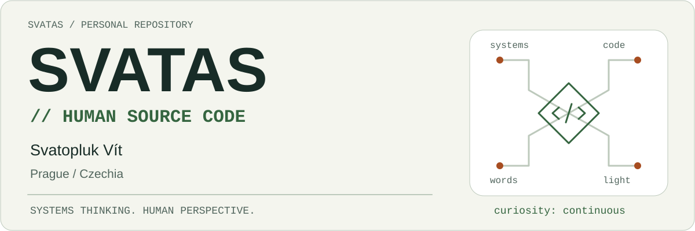
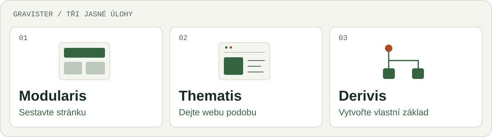
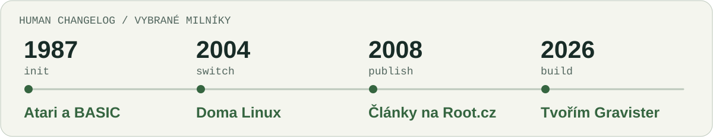

<!-- Generated by scripts/generate.py; edit profile/*.json instead. -->
<picture>
  <source media="(prefers-color-scheme: dark)" srcset="assets/hero-dark.svg">
  <source media="(prefers-color-scheme: light)" srcset="assets/hero-light.svg">
  
</picture>

[English](README.md) · **Česky**

# Svatopluk Vít / svatas

Propojuji systémy, vysvětluji technologie a stavím věci, které se dají používat. **30 let v IT**, doma Linux a v ruce fotoaparát pro okamžiky, které odmítají chvíli posedět.

> Složitosti se nevyhnete. Dělat z ní problém všech ostatních je volitelné.

## Čtyři způsoby, jak dávám věcem smysl

| Oblast | Co do ní přináším |
| --- | --- |
| **Architektura a integrace** | Podnikové systémy, SAP, API, EDI a bezpečnost. Zajímá mě, co se děje mezi krabičkami na diagramu. |
| **Linux a open source** | Linux používám denně od roku 2004. Testování, dokumentace, české překlady a občasná hádka s konfiguračním souborem. |
| **Psaní a vysvětlování** | Odborné články, praktické návody a přednášky. Srozumitelný jazyk je součást řešení. |
| **Fotografie a perspektiva** | TeamGym, pohyb a lidská stránka technologií. Další způsob, jak najít smysl ve složité scéně. |

## Tvořím Gravister

Moje produktová rodina pro **Grav 2 + Admin Next / Admin2**. Tři nástroje s jasně rozdělenými úlohami a jednoduchou myšlenkou: **Rychlý web. Čistý systém. Klid v hlavě.**

<picture>
  <source media="(prefers-color-scheme: dark)" srcset="assets/gravister-cs-dark.svg">
  <source media="(prefers-color-scheme: light)" srcset="assets/gravister-cs-light.svg">
  
</picture>

| Produkt | Účel |
| --- | --- |
| **Modularis** | Kompozice stránek: skládejte modulární obsah do stránky. |
| **Thematis** | Prezentace webu a šablony: dejte webu vlastní vizuální charakter. |
| **Derivis** | Základ odvozené šablony: vytvořte výchozí strukturu pro šablonu odvozenou z existující. |

Produkty jsou ve vývoji. Tady představuji jejich účel; veřejná vydání a odkazy na zdrojové kódy doplním, až budou dostupné.

## Human Changelog

Pár milníků. Člověk se zatím podle sémantického verzování neřídí.

<picture>
  <source media="(prefers-color-scheme: dark)" srcset="assets/human-changelog-cs-dark.svg">
  <source media="(prefers-color-scheme: light)" srcset="assets/human-changelog-cs-light.svg">
  
</picture>

**1987 · Atari a BASIC** — První počítač. Ze zvědavosti se stal návyk.

**2004 · Doma Linux** — Jiný operační systém. Trvalý způsob přemýšlení.

**2008 · Články na Root.cz** — Sdílím, co se učím, jazykem, kterému lidé rozumějí.

**2026 · Tvořím Gravister** — Zkušenosti převádím do nástrojů pro Grav 2.

## Slova mimo repozitář

Píšu česky o Linuxu, open source, praktických technologiích a fotografii. V mých [článcích na Root.cz](https://www.root.cz/autori/svatopluk-vit/) najdete praktické návody, recenze i občasný výlet za hranice klávesnice.

## Ozvěte se

Najdete mě na [LinkedIn](https://www.linkedin.com/in/svatopluk-v%C3%ADt/) nebo [Bluesky](https://bsky.app/profile/svatoplukvit.bsky.social). Web projektu: [Gravister](https://gravister.cz/).

---

*Pořád se učím. Pořád tvořím. Občasný restart je vlastnost.*
