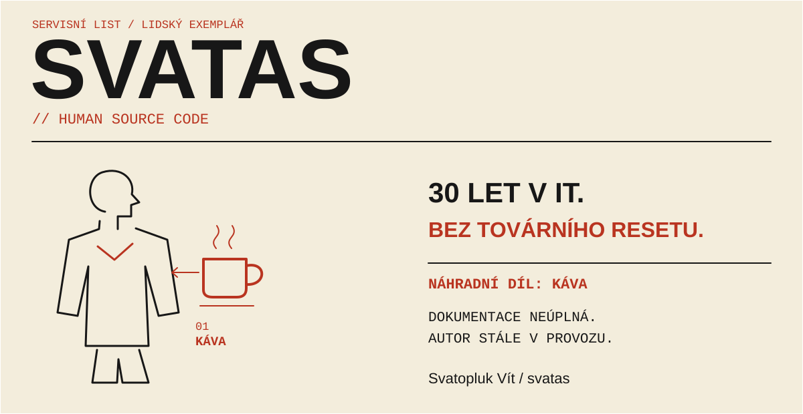

<!-- Generated by scripts/generate.py; edit profile/*.json instead. -->
<picture>
  <source media="(max-width: 600px) and (prefers-color-scheme: dark)" srcset="assets/hero-cs-mobile-dark.svg">
  <source media="(max-width: 600px) and (prefers-color-scheme: light)" srcset="assets/hero-cs-mobile-light.svg">
  <source media="(prefers-color-scheme: dark)" srcset="assets/hero-cs-dark.svg">
  <source media="(prefers-color-scheme: light)" srcset="assets/hero-cs-light.svg">
  
</picture>

[English](README.md) · **Česky**

# Svatopluk Vít / svatas

*30 let v IT. Pořád zvědavý.*

Propojuji podnikové systémy, stavím nástroje, vysvětluji technologie a fotografuji pohyb. Ve všech čtyřech oblastech hledám to, díky čemu celek začne dávat smysl.

## Vyberte si svou cestu

Čtyři výchozí body. Začněte tím, který vás zajímá. Moje články vycházejí česky.

<strong>Zpráva musí dorazit.</strong> — architektura / integrace / bezpečnost

API, EDI a SAP. Pracuji na částech, které se musejí dohodnout — včetně lidí, kteří je používají. Diagram je dobrý začátek; zajímavé otázky se skrývají v jeho spojnicích.

**Můj pohled:** Co se děje mezi krabičkami na diagramu?

[Z mého stolu: diagrams.net a srozumitelné diagramy](https://www.root.cz/clanky/diagrams-net-schemata-a-diagramy-levou-zadni-a-multiplatformne/)

<strong>Web má patřit svému majiteli.</strong> — Linux / open source / Gravister

Linux mám doma od roku 2004. Přispívám testováním, dokumentací a českými překlady. Teď stavím Gravister: nástroje pro sestavování stránek, podobu webu a vytváření odvozených šablon v Gravu 2.

**Můj pohled:** Rozumíte tomu, co vlastníte? Dokážete to udržovat a změnit?

[Z mého stolu: firmware a Linux, když aktualizace není samozřejmostí](https://www.root.cz/clanky/firmware-a-linux-kdyz-aktualizace-neni-samozrejmosti/)

[Prozkoumejte Gravister](https://gravister.cz/)

<strong>Když to funguje, vysvětlete proč.</strong> — články / praktické návody / přednášky

Píšu česky o Linuxu, fotografii a praktických technologiích. Rozumět nástroji patří k tomu, jak jej dobře používat. Baví mě hledat vysvětlení, po kterém si čtenář může něco skutečně vyzkoušet.

**Můj pohled:** Čemu čtenář potřebuje porozumět v dalším kroku?

[Z mého stolu: Yakuake, terminálový světelný meč](https://www.root.cz/clanky/yakuake-terminalovy-svetelny-mec-ktery-se-vysune-v-pripade-potreby/)

[Přečtěte si všechny moje články na Root.cz](https://www.root.cz/autori/svatopluk-vit/)

<strong>To, co fotíte, odmítá chvíli posedět.</strong> — TeamGym / fotografie / perspektiva

Fotím TeamGym. Pohyb, světlo a načasování tvoří jiný druh technického problému — s lidským okamžikem uprostřed. Ve fotografii se potká příprava s něčím, co si už nemůžete nechat zopakovat.

**Můj pohled:** Který okamžik stojí za uchování?

[Zpoza objektivu: jak probíhá focení gymnastických závodů](https://www.root.cz/clanky/z-praxe-amaterskeho-fotografa-jak-probiha-foceni-gymnastickych-zavodu/)

## Právě tvořím: Gravister

Web má být něco, čemu rozumíte, co můžete udržovat a upravit podle sebe. Tahle myšlenka dostává podobu v mé produktové rodině pro **Grav 2 + Admin Next / Admin2**.

**Modularis** — Kompozice stránek: skládejte modulární obsah do stránky.

**Thematis** — Prezentace webu a šablony: dejte webu vlastní vizuální charakter.

**Derivis** — Základ odvozené šablony: vytvořte výchozí strukturu pro šablonu odvozenou z existující.

Produkty jsou ve vývoji. Tady představuji jejich účel; veřejná vydání a odkazy na zdrojové kódy doplním, až budou dostupné.

[Prozkoumejte Gravister](https://gravister.cz/) · *Rychlý web. Čistý systém. Klid v hlavě.*

<strong>Human Changelog — zvědavost od roku 1987</strong>

Pár milníků. Člověk se zatím podle sémantického verzování neřídí.

**1987 · Atari a BASIC** — První počítač. Ze zvědavosti se stal návyk.

**2004 · Doma Linux** — Jiný operační systém. Trvalý způsob přemýšlení.

**2008 · Články na Root.cz** — Sdílím, co se učím, jazykem, kterému lidé rozumějí.

**2026 · Tvořím Gravister** — Zkušenosti převádím do nástrojů pro Grav 2.

## Pokračujme v rozhovoru

[LinkedIn](https://www.linkedin.com/in/svatopluk-v%C3%ADt/) · [Bluesky](https://bsky.app/profile/svatoplukvit.bsky.social) · [Všechny moje články na Root.cz](https://www.root.cz/autori/svatopluk-vit/)

---

*Z Karviné. Doma v Praze. Zvědavý od roku 1987. Pořád v péči.*
