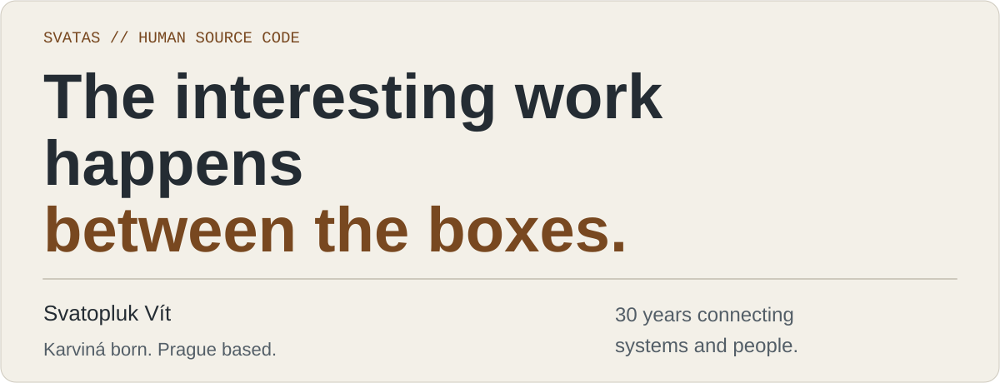

<!-- Generated by scripts/generate.py; edit profile/*.json instead. -->
<picture>
  <source media="(max-width: 600px) and (prefers-color-scheme: dark)" srcset="assets/hero-en-mobile-dark.svg">
  <source media="(max-width: 600px) and (prefers-color-scheme: light)" srcset="assets/hero-en-mobile-light.svg">
  <source media="(prefers-color-scheme: dark)" srcset="assets/hero-en-dark.svg">
  <source media="(prefers-color-scheme: light)" srcset="assets/hero-en-light.svg">
  
</picture>

**English** · [Česky](README.cs.md)

# Svatopluk Vít / svatas

*30 years in IT. Still curious.*

I connect enterprise systems, build tools, explain technology and photograph motion. In all four, I look for the part that makes the whole thing make sense.

## Follow a thread

Four starting points. Choose the one that interests you. My articles are in Czech.

<strong>A message has to arrive.</strong> — architecture / integration / security

APIs, EDI and SAP. I work on the parts that have to agree with each other — including the people who use them. A diagram is a useful start; the interesting questions live in its connections.

**My lens:** What happens between the boxes in a diagram?

[From my desk: diagrams.net, a tool for making connections visible](https://www.root.cz/clanky/diagrams-net-schemata-a-diagramy-levou-zadni-a-multiplatformne/)

<strong>A website should belong to its owner.</strong> — Linux / open source / Gravister

Linux at home since 2004. Testing, documentation and Czech translations are part of how I contribute. Now I am building Gravister: tools for composing pages, shaping presentation and creating derived themes in Grav 2.

**My lens:** Can you understand, maintain and change what you own?

[From my desk: firmware and Linux, when updating is not a given](https://www.root.cz/clanky/firmware-a-linux-kdyz-aktualizace-neni-samozrejmosti/)

[Explore Gravister](https://gravister.cz/)

<strong>If it works, explain why.</strong> — articles / practical guides / talks

I write in Czech about Linux, photography and practical technology. Understanding a tool is part of using it well. I enjoy finding an explanation that gives the reader something they can actually try.

**My lens:** What does the reader need to understand next?

[From my desk: Yakuake, a terminal that appears when you need it](https://www.root.cz/clanky/yakuake-terminalovy-svetelny-mec-ktery-se-vysune-v-pripade-potreby/)

[Read all my articles on Root.cz](https://www.root.cz/autori/svatopluk-vit/)

<strong>The subject refuses to stand still.</strong> — TeamGym / photography / perspective

I photograph TeamGym. Motion, light and timing create a different kind of technical problem — with a human moment at its centre. The photograph is where the preparation meets something you cannot ask to happen again.

**My lens:** Which moment is worth keeping?

[From behind the lens: photographing gymnastics competitions](https://www.root.cz/clanky/z-praxe-amaterskeho-fotografa-jak-probiha-foceni-gymnastickych-zavodu/)

## Current build: Gravister

A website should be something you can understand, maintain and make your own. That idea is taking shape as my product family for **Grav 2 + Admin Next / Admin2**.

**Modularis** — Page composition: arrange modular content into a page.

**Thematis** — Site and theme presentation: give the website its visual character.

**Derivis** — Derived-theme scaffolding: create a starting structure for a theme derived from an existing one.

These products are in development. This is an introduction to their purpose; public releases and source links will be added when available.

[Explore Gravister](https://gravister.cz/) · *Fast websites. Clean systems. Peace of mind.*

<strong>Human Changelog — curiosity since 1987</strong>

A few milestones. No semantic versioning for the person.

**1987 · Atari & BASIC** — The first computer. Curiosity became a habit.

**2004 · Linux at home** — A different operating system. A lasting way of thinking.

**2008 · Writing on Root.cz** — Sharing what I learn, in a language people understand.

**2026 · Building Gravister** — Turning experience into tools for Grav 2.

## Continue the conversation

[LinkedIn](https://www.linkedin.com/in/svatopluk-v%C3%ADt/) · [Bluesky](https://bsky.app/profile/svatoplukvit.bsky.social) · [All my articles on Root.cz](https://www.root.cz/autori/svatopluk-vit/)

---

*Karviná born. Prague based. Curiosity since 1987. Still maintained.*
