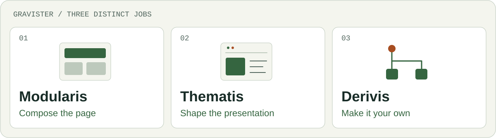
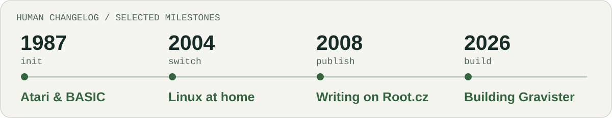

<!-- Generated by scripts/generate.py; edit profile/*.json instead. -->
<picture>
  <source media="(prefers-color-scheme: dark)" srcset="assets/hero-dark.svg">
  <source media="(prefers-color-scheme: light)" srcset="assets/hero-light.svg">
  
</picture>

**English** · [Česky](README.cs.md)

# Svatopluk Vít / svatas

I connect systems, explain technology, and build things people can actually use. **30 years in IT**, a Linux home, and a camera for the moments that refuse to sit still.

> Complexity is inevitable. Making it everybody else's problem is optional.

## Four ways I make sense of things

| Area | What I bring |
| --- | --- |
| **Architecture & integration** | Enterprise systems, SAP, APIs, EDI and security. I care about what happens between the boxes in a diagram. |
| **Linux & open source** | A daily Linux user since 2004. Testing, documentation, Czech translations and the occasional argument with a configuration file. |
| **Writing & explaining** | Technology articles, practical guides and talks. Clear language is part of the solution. |
| **Photography & perspective** | TeamGym, motion and the human side of technology. Another way to make sense of a complicated scene. |

## Building Gravister

My product family for **Grav 2 + Admin Next / Admin2**. Three tools with distinct jobs, built around a simple idea: **Fast websites. Clean systems. Peace of mind.**

<picture>
  <source media="(prefers-color-scheme: dark)" srcset="assets/gravister-en-dark.svg">
  <source media="(prefers-color-scheme: light)" srcset="assets/gravister-en-light.svg">
  
</picture>

| Product | Purpose |
| --- | --- |
| **Modularis** | Page composition: arrange modular content into a page. |
| **Thematis** | Site and theme presentation: give the website its visual character. |
| **Derivis** | Derived-theme scaffolding: create a starting structure for a theme derived from an existing one. |

These products are in development. This is an introduction to their purpose; public releases and source links will be added when available.

## Human Changelog

A few milestones. No semantic versioning for the person.

<picture>
  <source media="(prefers-color-scheme: dark)" srcset="assets/human-changelog-en-dark.svg">
  <source media="(prefers-color-scheme: light)" srcset="assets/human-changelog-en-light.svg">
  
</picture>

**1987 · Atari & BASIC** — The first computer. Curiosity became a habit.

**2004 · Linux at home** — A different operating system. A lasting way of thinking.

**2008 · Writing on Root.cz** — Sharing what I learn, in a language people understand.

**2026 · Building Gravister** — Turning experience into tools for Grav 2.

## Words outside the repository

I write in Czech about Linux, open source, practical technology and photography. Explore my [articles on Root.cz](https://www.root.cz/autori/svatopluk-vit/) for practical guides, reviews and the occasional detour beyond the keyboard.

## Say hello

Find me on [LinkedIn](https://www.linkedin.com/in/svatopluk-v%C3%ADt/) or [Bluesky](https://bsky.app/profile/svatoplukvit.bsky.social). For the project family, visit [Gravister](https://gravister.cz/).

---

*Still learning. Still building. The occasional reboot is a feature.*
